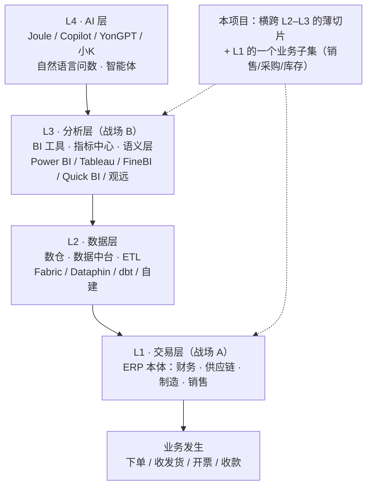

# ERP 与经营分析平台 · 竞品分析

> 版本：v1.0 ｜ 撰写日期：2026-11-25 ｜ 分析对象：主流 ERP 产品、主流 BI/分析平台、本项目（ERP 经营分析实验室）

---

## 0. 读这份文档前必须知道的三件事

**① 价格不是重点，结构才是。**
ERP 是典型的「报价即谈判起点」行业：同一款产品，5 个用户和 500 个用户、标准模块和深度定制、公有云和私有化，价格能差 10 倍。本文给出的数字是**公开标价或第三方渠道口径**，只用于判断量级，不能用于做预算。

**② 我们和 SAP 不在一个货架上。**
本项目没有总账、没有应收应付、没有生产工单、没有多组织。硬把它和 SAP S/4HANA 摆在一张表里比功能数量，结论必然是我们全面落败，且毫无意义。
所以本文把竞品拆成**两个战场**：
- 战场 A：**交易层**（ERP 本体）—— 我们不进去，只借用它的数据模型语言；
- 战场 B：**分析层**（BI / 指标 / 经营洞察）—— 我们真正站的位置。

**③ 数据来源与时点。**
产品结构与定位信息来自各厂商官网及 2026 年第三方横评（详见附录）。AI 能力部分变化极快，2026 年内多家已从「Copilot 助手」转向「智能体（Agent）」，本文按 2026-11 的公开信息记录。价格口径：官方标价 > 第三方渠道口径 > 需询价。

---

## 1. 结论先行

### 1.1 一句话定位

> **本项目不是 ERP，是一个「口径可验证、结论可复现」的 ERP 经营分析层样本。**
> 它用一套仿真的 B2B 经销业务数据，把 SQL / Excel / Power BI / Tableau 四个工具串成一条互相印证的链路。

### 1.2 五条核心判断

| # | 判断 | 依据 |
|---|---|---|
| 1 | **ERP 的分析能力普遍是「后置外挂」，不是原生一等公民** | SAP 靠 BPC/SAC/Embedded Analytics，D365 靠 Power BI + Fabric，NetSuite 靠 SuiteAnalytics，用友/金蝶各自推独立数据中台。没有一家把「口径可验证」做成产品主线 |
| 2 | **国内厂商的差异化在「一体化底座」，海外厂商在「生态与合规」** | 用友 YonSuite 主打统一底座十大领域，金蝶靠苍穹平台 + 灵基低代码；SAP/NetSuite 打的是全球合规、多币种、多准则 |
| 3 | **2026 年的竞争焦点已从「有没有 AI」变成「AI 的答案能不能被验证」** | 各家都有 Copilot/智能体（Joule、Copilot、YonGPT、小K），但普遍无法回答「这个数怎么算出来的」。可溯源成为新分水岭 |
| 4 | **我们的真竞品不是 ERP，是 BI 工具 + ERP 自带报表 + 别人的作品集** | 见 §6.1「谁才是我们的竞品」 |
| 5 | **我们最硬的差异点是「可复现 + 可验证」，不是功能多** | 20 组 SQL 双方言逐值一致、库存对账差异恒为 0、种子数据 seed=42 确定性、每条洞察附证据 SQL |

### 1.3 优势 / 劣势一句话版

- **优势**：口径钉死、结论可回链、全链路一键复现、AI 价值可量化、四种工具交叉验证 —— 这五点在商业产品里反而是最贵、最难做好的部分。
- **劣势**：没有交易闭环的财务侧（无总账/AR/AP）、无生产、无多组织多币种、无多租户、数据是合成的、规模只到万级、无移动端、无实时增量。

---

## 2. 市场分层地图



**分层的目的**：把「谁跟谁抢生意」讲清楚。
ERP 厂商往 L2/L3 上探（SAP 有 SAC、D365 有 Fabric），BI 厂商往 L2 下沉（帆软做 FineDataLink），我们在 L2–L3 做了个很薄但**端到端闭合**的切片。

---

## 3. 主流 ERP 产品结构横向对比

### 3.1 分档原则

ERP 市场不是一条连续的线，而是三层断崖，**跨层比较没有意义**：

| 档位 | 客户画像 | 年软件支出量级 | 决策周期 | 代表产品 |
|---|---|---|---|---|
| Tier 1 大型/集团 | 营收 > 50 亿、多法人多国 | 百万～千万级 | 12–24 个月 | SAP S/4HANA、Oracle Fusion Cloud ERP、D365 F&O |
| 成长型中端 | 营收 5000 万～30 亿、单/多工厂 | 数万～数十万 | 3–9 个月 | NetSuite、D365 BC、用友 YonSuite/U8、金蝶 AI 星空、鼎捷、Acumatica |
| 小微 / 开源 | < 100 人、流程简单 | 千元～数万 | 数天～数周 | Odoo、管家婆、速达、金蝶精斗云 |

### 3.2 Tier 1：大型集团（架构深度之争）

| 维度 | SAP S/4HANA | Oracle Fusion Cloud ERP | Microsoft D365 F&O |
|---|---|---|---|
| **架构基因** | 组件化套件 + HANA 内存库；从 R/3 演进而来 | 云原生 SaaS，与 HCM/EPM/SCM 同库同套 | 模块化应用 + Dataverse 统一数据层 |
| **产品结构** | 25 个主模块，分功能/技术/平台三层；FI/CO/MM/SD/PP/PM/QM 等 | 财务、项目、采购、风险、EPM 五大云，共享统一数据模型 | Finance、Supply Chain Management、Commerce、Project Operations 拆成独立 App 按需购买 |
| **核心优势** | 制造业深度、全球合规、审计留痕、行业模板最厚 | 大交易量财务、合并报表、全球税务与资金 | 与 M365/Teams/Power BI/Fabric 原生打通；TCO 低于 SAP |
| **主要代价** | 实施 12–24 个月，TCO 常被引用为 300 万～500 万美元/5 年；人才稀缺 | 实施 18–24 个月；专用顾问昂贵；对简单业务过度设计 | 模块化带来治理负担，容易造出「数字孤岛」 |
| **分析能力** | SAC + Embedded Analytics；Joule 智能体 | Oracle Analytics + AI Agent | Power BI + Fabric（同集团产品，天然近） |
| **公开价目** | 无标准价；第三方估算年费 50 万美元级起 | 无标准价，按模块/用户议价 | Finance / SCM 各 **$180/用户/月**（微软公开价目） |
| **最适合** | 全球制造、化工、医药、汽车等复杂供应链 | 金融、电信、公用事业的超复杂财务 | 已深度使用微软技术栈的中大型企业 |

### 3.3 成长型中端：真正的红海（产品结构差异最大的一档）

| 维度 | Oracle NetSuite | D365 Business Central | 用友 YonSuite | 金蝶 AI 星空 | Odoo |
|---|---|---|---|---|---|
| **架构** | 单一代码库、单一数据库（ERP+CRM+电商同库） | 单一应用，云优先，微软托管 | 云原生微服务，500+ 可组装服务模块 | 基于金蝶苍穹平台（低代码 + 中台） | Python 后端 + PostgreSQL，80+ 官方模块 |
| **产品结构** | 财务/CRM/电商/PS 四大套件，OneWorld 管多子公司 | 财务、供应链、销售服务、项目、制造、分析六域 | 财税/人力/供应链/营销/采购/制造/研发/项目/资产/协同 **十大领域** | 财务云/税务云/供应链云/制造云/PLM云/项目云 + PLM+ERP+MES 一体 | 财务、销售、网站、物流、服务、营销、人力等**应用集市** |
| **差异化卖点** | 多实体合并 + 快速扩张期的「单一真相源」 | 微软生态原生、上手快、3–6 个月可上线 | 统一底座 + 3 万+ 客户 + 40 国会计准则 | 业财税一体 + 制造深度 + 「小K」智能体 + 灵基低代码 | 模块化 + 可自托管 + 单价最低 |
| **分析能力** | SuiteAnalytics（内置 Workbook） | 内置报表 + Power BI/Fabric | 总裁视角实时洞察 + YonGPT 自然语言分析 | 星空 AI 套件 + 小K 分析 | 内置 Spreadsheets(BI) + 第三方 BI |
| **AI 路线** | NetSuite AI Copilot + Agents | Copilot 已含在许可内 | YonGPT + 千余智能体 | 小K 系列（制单/排产/插单模拟/风险洞察） | 原生 AI + 开放扩展 |
| **公开价目** | 平台费 + 约 $99–150/用户/月（第三方口径，需议价） | Essentials **$70**、Premium **$100**、Team Members **$8** /用户/月 | 订阅制，按模块+用户询价 | 许可 + 订阅，项目报价 | Standard **$24.90**、Custom **$49.00** /用户/月（年付）；Community 免费（LGPL v3） |
| **最适合** | 多子公司、跨境、准备 IPO 的成长企业 | 微软体系内的中小到中端 | 制造与出海、要一体化底座的成长企业 | 中型制造、装备/汽配/电子 | 有技术团队、要低成本自托管 |

### 3.4 同一张表看「产品结构的四种范式」

| 范式 | 代表 | 结构特征 | 客户得到的 | 客户付出的 |
|---|---|---|---|---|
| **单体套件** | SAP S/4HANA | 一套代码、按模块开关 | 极致深度与合规 | 实施周期与人才成本 |
| **统一数据模型云** | NetSuite、Odoo | 一个库装所有业务，无同步延迟 | 数据天然一致 | 必须接受它的流程范式 |
| **模块化生态** | D365 | 独立 App 按需买，Dataverse 缝合 | 只买要用的 | 治理与集成复杂度 |
| **平台 + 应用** | 金蝶苍穹、用友 BIP | 低代码底座，应用长在上面 | 自己可改流程 | 平台学习曲线 |

**关键观察（对我们的启示）**：
四种范式里，**分析能力全部是「后置」的**——要么靠外挂 BI，要么靠内置报表模块。没有一家把「指标口径的唯一定义 + 结论可溯源」当作产品主线来卖。这不是他们做不到，而是**卖 ERP 的人靠流程落地赚钱，不靠分析准确性赚钱**。这个空档就是我们的叙事空间。

---

## 4. 分析层（战场 B）横向对比

| 维度 | Power BI | Tableau | FineBI（帆软） | Quick BI（阿里云/瓴羊） | 观远 BI | Superset / Metabase |
|---|---|---|---|---|---|---|
| **定位** | 微软生态 BI 龙头 | 可视化探索标杆 | 国产企业级自助 BI | 云生态 BI + AI 分析 | 零售消费行业 BI | 开源轻量 BI |
| **语义层** | 语义模型（DAX）成熟 | 数据源 + 计算字段 | **指标中心 + 全链路血缘**（强项） | 数据集 + 数据词典 | 指标 + 场景模型 | 弱 |
| **AI 问数** | Copilot | 基础数据解释 | 分析 Agent + 场景 Agent，**三级溯源（指标/模型/数据）** | 智能小Q | ChatBI + 洞察 Agent | 无 |
| **可视化** | 中上，够用 | **最强** | 强（含大屏） | 中上（50+ 图表） | 中上（大屏较弱） | 中 |
| **嵌入/集成** | 强（Teams/SharePoint） | 中 | 强（私有化、信创） | 强（钉钉/阿里云） | 中上 | 强（可嵌自家系统） |
| **私有化** | 弱（云为主） | 中（Server） | **强** | 弱 | 强 | **强** |
| **成本** | 低（按用户/容量） | 高 | 中高（按项目） | 中 | 中高 | **零授权** |
| **最适合** | 微软栈、报表为主 | 分析团队成熟、重探索 | 报表复杂、要指标治理 | 阿里云/钉钉生态 | 零售连锁 | 技术团队自建 |

**这张表对求职最有用的信息**：企业真正在花钱解决的不是「画图」，而是**口径不一致**。佐证是帆软连续九年位居中国 BI 市场份额第一（赛迪顾问口径），而其核心卖点之一正是「指标中心 + 全链路血缘」。这正好是我们项目讲的故事。

---

## 5. 竞品分析方法：三个工具

### 5.1 功能矩阵（我们 vs 六个代表）

见 §7 的三态对账表。

### 5.2 波特五力（以「ERP 经营分析层」为分析单元）

| 五力 | 强度 | 判断依据 |
|---|---|---|
| **同业竞争** | 🔴 极高 | BI 工具同质化严重；ERP 厂商把分析当赠品捆绑（Power BI 随 M365、Copilot 含在许可内），独立分析产品被「免费化」挤压 |
| **新进入者威胁** | 🔴 高 | 开源（Superset/Metabase）+ LLM 让「搭一个能看的看板」门槛降到几天；真正的壁垒只剩数据治理与业务理解 |
| **替代品威胁** | 🟠 中高 | Excel 仍是最大替代品；ERP 自带报表满足 60% 日常需求；「不投分析、只加人」是常态选择 |
| **供应商议价力** | 🟠 中高 | 上游是云与模型（模型调用成本、云存储）；国产替代降低了云侧锁定，但模型侧仍在集中 |
| **买方议价力** | 🔴 极高 | 客户可自建、可比价、可先用开源试；决策链上 CFO/IT/业务三方都要点头 |

**结论**：这是一个**买方强势、替代品泛滥**的市场。唯一的活路是**把「不可替代的判断力」做成产品**——也就是口径、业务理解、可验证性，而不是图表数量。

### 5.3 价值曲线（1–5 分，主观打分）

| 维度 | SAP | NetSuite | D365 BC | 用友/金蝶 | Odoo | FineBI | **本项目** |
|---|---|---|---|---|---|---|---|
| 交易流程深度 | 5 | 4 | 4 | 5 | 3 | 0 | **1** |
| 财务合规能力 | 5 | 5 | 4 | 5 | 2 | 0 | **0** |
| 多组织/多币种 | 5 | 5 | 3 | 4 | 3 | 2 | **0** |
| 行业模板厚度 | 5 | 4 | 4 | 4 | 3 | 3 | **1** |
| 实施与服务 | 5 | 4 | 4 | 5 | 2 | 4 | **1** |
| 可视化表现力 | 3 | 3 | 4 | 3 | 2 | 4 | **3** |
| **口径可验证性** | 3 | 2 | 3 | 3 | 1 | 4 | **5** |
| **结论可复现性** | 2 | 2 | 2 | 2 | 2 | 3 | **5** |
| **AI 价值量化** | 2 | 2 | 2 | 2 | 1 | 2 | **4** |
| **上手/复现成本** | 1 | 2 | 3 | 2 | 3 | 3 | **5** |

> 读法：我们在左侧四行（交易与合规）接近 0，这是**结构性放弃**，不是做不好；右侧四行（可验证/可复现/AI 量化/低成本）明显高出一档，这是**刻意做出的差异化**。
> 这张曲线能直接回答面试官的必问题：「你和那些大厂产品比，优势在哪？」

---

## 6. 我们的位置

### 6.1 谁才是我们的竞品

这是本文最重要的一节。把竞品选错，后面全是自嗨。

| 层级 | 真竞品 | 竞争方式 | 我们的相对位置 |
|---|---|---|---|
| **表象对手** | SAP / NetSuite / 用友 / 金蝶 | 交易层功能对比 | ❌ 不构成竞争，也不该比 |
| **直接对手 1** | BI 工具：Power BI / Tableau / FineBI / Quick BI | 谁能把数看明白 | ⚠️ 我们用它们作为交付载体，是**互补不是替代** |
| **直接对手 2** | ERP 自带报表 / SuiteAnalytics / 内置看板 | 「我已经有了，为什么还要你」 | ✅ 我们的差异是「口径可验证」，他们给不了 |
| **直接对手 3** | 数据中台 / 指标平台（Dataphin、FineDataLink、dbt） | 谁定义指标、谁管血缘 | ⚠️ 我们只有文档级口径，没有引擎级血缘 |
| **隐性对手** | 其他候选人的作品集、GitHub 上的 ERP/BI demo | 面试官的时间与注意力 | ✅ 可复现 + 双库对账 + 四工具印证，极少有人做到 |

**一句话**：如果一个岗位问「你会不会用 BI」，我们的对手是别的候选人；如果问「你能不能把口径讲清楚」，我们几乎没有对手。

### 6.2 能力对账表（三态）

图例：✅ 已具备可用 ｜ ⚠️ 部分具备/仅到示意 ｜ ❌ 未覆盖

| # | 能力项 | 主流 ERP | 本项目 | 说明 |
|---|---|---|---|---|
| 1 | 销售订单（含明细、状态、退货） | ✅ | ✅ | 5,727 单 / 15,201 明细，含已完成/处理中/已取消/退货 |
| 2 | 采购订单 | ✅ | ✅ | 3,514 单，支撑库存对账闭环 |
| 3 | 库存收发存与对账 | ✅ | ✅ | 18,358 笔流水、3,840 条月末快照，**期初+入−出+退−报废=期末，差异恒为 0** |
| 4 | 客户/产品/员工/供应商主数据 | ✅ | ✅ | 60/80/18/10 条，含行业、区域、渠道、成本、安全库存 |
| 5 | 总账 / 应收 / 应付 / 成本核算 | ✅ | ❌ | **最大结构性缺口**，无凭证、无科目、无期间结账 |
| 6 | 生产制造 / MRP / BOM | ✅（SAP/用友/金蝶尤强） | ❌ | 纯经销场景，不涉及产能与工单 |
| 7 | 多组织 / 多法人 / 多币种 | ✅ | ❌ | 单主体、单币种（CNY） |
| 8 | 税务 / 合规 / 审计留痕 | ✅ | ❌ | 有 request_id 结构化日志，但**不是审计级**（不可作为财务证据） |
| 9 | CRM 线索 → 商机 → 成单 | ✅ | ⚠️ | 有 1,062 条漏斗事实表与阶段流失分析，**无 CRM 交互界面** |
| 10 | 客服工单 | ✅ | ⚠️ | 765 条事实 + AI/人工对照，无工单流转 |
| 11 | 营销投放 CAC / ROAS | ⚠️（多为外挂） | ✅ | 144 条月度渠道投放，BI 层可直接算 CAC/ROAS |
| 12 | 自助看板 | ✅ | ✅ | 8 个视图、21 个 API、原生 JS 无构建 |
| 13 | 语义层 / 指标中心 | ✅（FineBI 最强） | ⚠️ | 口径写入 `docs/数据字典与业务口径.md` 与代码，**文档级一致，非引擎级血缘** |
| 14 | 权限粒度 | ✅（行/列级） | ⚠️ | 4 角色功能级 RBAC，**无行级/列级数据权限** |
| 15 | 多租户 SaaS | ✅ | ❌ | 单租户本地部署 |
| 16 | 开放 API / 集成 | ✅ | ⚠️ | 21 端点 + 自动 OpenAPI 文档，无 webhook、无第三方连接器 |
| 17 | 移动端 | ✅ | ❌ | 仅桌面 Web，有响应式断点 |
| 18 | 实时 / 增量更新 | ✅ | ❌ | 全量重算，非 CDC/流式 |
| 19 | AI 自然语言问数 | ✅（2026 全面铺开） | ⚠️ | 规则型洞察引擎（每条附证据 SQL），**无 NL2SQL** |
| 20 | AI 价值量化 | ❌（普遍只讲不量） | ✅ | 商机/工单/助手三组 A/B 对照，**这是商业产品普遍缺失的** |
| 21 | 确定性可复现 | ❌ | ✅ | seed=42，任何人重跑得到同一份数据与同一个数 |
| 22 | 跨方言/跨工具一致性验证 | ❌ | ✅ | 20 组 SQL（SQLite/MySQL 逐值一致）+ 4 工具同口径交叉 |

**统计**：22 项中 ✅ 8 项、⚠️ 7 项、❌ 7 项。
**关键结论**：❌ 的 7 项里，5 项（总账、生产、多组织、多租户、移动端）属于**「做 ERP」才需要的能力**，与「做分析」关系不大；真正影响分析说服力的缺口只有 3 个：**行级权限、引擎级血缘、实时增量**。这 3 个恰好都在我们的优化路线 P0/P1 里。

---

## 7. 我们的优点（每条都给证据）

### 7.1 口径唯一，且能被验证 —— 这是最贵的能力

商业 BI 卖「指标中心」卖得很贵，因为口径不一致是企业最痛的问题。我们把它做到了可验证：

- 营收口径恒为 `order_status='已完成' AND is_return=0`，全项目只此一处定义；
- 比值一律「先聚合再相除」，避免平均的平均；
- 计数一律 COUNTD，避免明细表 join 后的重复计数；
- 结果：**同一指标在 4 个工具（SQL / Excel / Power BI / Tableau）算出同一个数**。

### 7.2 库存对账差异恒为 0 —— 有硬校验，不是「看起来对」

18,358 笔库存流水 + 3,840 条月末快照，`期初 + 采购入库 − 销售出库 + 退货入库 − 报废 = 期末`，全期差异为 0，且无负库存。
这不是演示数据「凑」出来的，是 `tests/test_api.py` 里两条断言每天在守：
`test_inventory_reconciliation_is_zero`、`test_no_negative_stock`。

### 7.3 结论可回链 —— 每条洞察都带证据 SQL

`/api/ai/insights` 返回的每条洞察都带 `evidence_sql` 字段，点开就能复算。
对照现实：多数 BI 的「智能洞察」是个黑盒，你只能选择信或不信。**可验证性正是 2026 年 AI 分析产品的新分水岭**（帆软把三级溯源做成核心卖点即是证据）。

### 7.4 AI 价值可量化 —— 商业产品普遍缺失

我们把「AI 到底值多少钱」拆成三组可对照的事实表：

| 对照组 | 度量方式 | 业务含义 |
|---|---|---|
| AI 辅助商机 vs 纯人工商机 | 成单率、周期、客单价 | AI 在销售侧值多少 |
| AI 承接工单 vs 人工工单 | 首响时长、解决时长、满意度 | AI 在服务侧省多少 |
| 销售助手调用 | 调用量、采纳率、节省工时 | AI 在效率侧换多少 |

这个视角直接对应「AI 产品销售」这个岗位命题：**卖 AI 的人如果算不出 AI 的钱，就只能靠讲故事。**

### 7.5 全链路可复现 —— 别人给不了「你也能跑一遍」

```bash
python scripts/seed_db.py --reset && python -m uvicorn app.main:app --port 8000
```

两条命令，从零到看板。seed=42 保证任何人得到同一份数据。
商业产品的 demo 环境永远是「厂商的一台服务器 + 一个演示账号」，你无法验证它。**可复现性是我们对商业产品最不对等的优势。**

### 7.6 双库同跑 —— 证明的是「懂 SQL」，不是「会点按钮」

20 组分析脚本，SQLite 与 MySQL 8 两套方言，结果逐值一致；转换脚本自动生成而非手改，避免漂移。
过程中踩到的真坑（并列排序缺 tiebreaker、`div_precision_increment`、`MAX(a,b)` 要写 `GREATEST`）都写进了技术文档 —— **这些才是面试时能聊 20 分钟的细节**。

---

## 8. 我们的缺点（不修饰）

### 8.1 结构性缺口：没有财务侧

没有总账、应收、应付、成本核算、期间结账。
**后果**：算不出毛利以下的任何数 —— 净利、ROE、现金流、账龄、DSO。所有分析止步于「毛利」，这是天花板级的限制。
企业里真正拍板买 BI 的是 CFO，而 CFO 看的恰恰是我们算不出来的那部分。

### 8.2 数据是合成的 —— 最大硬伤

真实 ERP 项目实施中，**70% 的工作量在脏数据治理**：一物多码、客户重名、单位不统一、负库存、跨期调整、反结账。
我们的数据「脏得很干净」—— 脏是设计好的脏（退货、取消、报废），不是真实世界的脏。
**后果**：无法证明数据清洗与治理能力，而这正是数据分析岗的核心考察点之一。

### 8.3 规模只到万级，没有性能证据

5,727 单 / 15,201 明细 / 18,358 流水，单机 SQLite，单用户。
没有任何并发、索引优化、慢查询治理、大表分区的实证。商业产品会问：100 万单、50 个并发用户时你还跑得动吗？**目前答不了。**

### 8.4 权限只到功能级，没有数据级

4 个角色（admin/analyst/sales/viewer）+ 功能权限。
没有行级（销售只能看自己的客户）、列级（隐藏成本价）、字段脱敏（手机号打码）。
这在真实企业里是**上线前的一票否决项**。

### 8.5 无实时、无增量

全量重算。业务问「今天上午卖了多少」，我们答不了。
2026 年的 BI 竞争已经把「分钟级」当及格线（观远 DataFlow 秒级同步、Quick BI 十亿级聚合 0.5 秒），我们停留在 T+1。

### 8.6 无移动端、无国际化

只有桌面 Web。多币种、多语言、多时区全无。

### 8.7 「AI」这块名不副实（必须自己先承认）

`/api/ai/insights` 是**规则型**洞察引擎（阈值 + 对比 + 模板），不是大模型。
叫它「AI 洞察」在营销上没错，但被追问「你用了什么模型、怎么做 RAG、幻觉怎么控」时会立刻露底。**主动说明是规则引擎 + 预留 LLM 接入点，比被拆穿好得多。**

---

## 9. 各自特点：一句话画像

| 产品 | 一句话特点 | 它最强的地方 | 它最贵/最痛的地方 |
|---|---|---|---|
| **SAP S/4HANA** | 全球复杂制造的工业标准 | 制造深度、合规、审计链 | 实施周期与顾问成本，改一次流程要排期 |
| **Oracle NetSuite** | 一个库装下所有子公司的「单一真相源」 | 多实体合并、快速扩张期的一致性 | 必须按它的流程走，本地化靠伙伴 |
| **D365 BC** | 微软体系里最不容易买错的 ERP | 与 M365/Power BI 原生、上手快、单价透明 | 复杂制造要上 F&O，跨越后价格跳档 |
| **D365 F&O** | 大企业里 TCO 最低的 Tier1 选项 | 模块化按需买 + Fabric 分析 | 模块化治理，容易造数字孤岛 |
| **用友 YonSuite** | 一个底座长出十个领域 | 一体化、3 万+ 客户、出海合规 | 制造深度弱于金蝶，重定制仍要项目化 |
| **金蝶 AI 星空** | 业财税一体 + 制造不缺席 | 制造深度、PLM+ERP+MES 一体、低代码 | 模块边界复杂，一上来全开成本高 |
| **Odoo** | 用 1/10 的价格买到 80% 的功能 | 单价最低、可自托管、可改源码 | 「免费」的是软件，不是人 —— 没人维护就成负债 |
| **Power BI** | 微软生态里最划算的 BI | 与 Office/Fabric/Teams 无缝、单价低 | 私有化弱，国内部署与合规要额外方案 |
| **Tableau** | 分析体验的天花板 | 可视化表现力与探索流畅度 | TCO 高，不解决口径治理 |
| **FineBI** | 把「指标口径」当产品卖 | 指标中心 + 全链路血缘 + 私有化 | 实施与培训投入大，AI 问数依赖指标基础 |
| **Quick BI** | 长在阿里云与钉钉里的 BI | 云原生、十亿级聚合、嵌入方便 | 深度绑定阿里云生态 |
| **观远 BI** | 零售消费行业的经营分析专家 | 行业 know-how、ChatBI 可验证 | 大屏非强项，行业外优势递减 |
| **Superset / Metabase** | 零授权费的自建起点 | 免费、可嵌、部署简单 | 没人为口径负责，最后仍需人来治理 |
| **本项目** | 一个人的「口径可验证」分析样本 | 可复现、可回链、四工具交叉验证、AI 价值可量化 | 无财务侧、数据合成、无并发与实时 |

---

## 10. 优化路线（按「投入产出比 × 对说服力的提升」排序）

### P0：补掉「一票否决项」（1–2 周量级）

| # | 动作 | 为什么必须先做 | 验收标准 |
|---|---|---|---|
| 1 | **加最小财务闭环**：科目表 + 凭证 + 应收/应付 + 期间结账 | 没有净利就上不了 CFO 的桌 | 能从销售订单 + 采购 + 费用推出**毛利→营业利润→净利**，且与现有营收口径对齐；月末结账后试算平衡 |
| 2 | **行级 + 列级权限** | 企业上线前的一票否决 | `sales` 角色只能查到自己名下的客户与订单；`viewer` 看不到成本价字段；两条 pytest 断言守住 |
| 3 | **脏数据注入包** | 补上最大的硬伤：治理能力无从证明 | 提供 `--dirty` 参数，注入一物多码/客户重名/单位不一/跨期调整；并交付一份清洗前后对账报告，说明每条规则的影响行数 |

### P1：把「分析层」做深（1 个月量级）

| # | 动作 | 验收标准 |
|---|---|---|
| 4 | **指标中心（轻量语义层）** | 把 20 个 SQL 的口径抽成 `metrics.yaml`（名称/口径/依赖/责任人），后端与 BI 都从此生成；改一次口径，SQL、API、看板同步变 |
| 5 | **血缘与影响分析** | 任选一个指标，能列出它依赖的表/字段与下游看板；被引用处可查 |
| 6 | **实时/增量** | 订单表改为增量入仓（按 `updated_at` 水位线），看板展示「数据延迟」而非假装实时；T+1 → T+分钟 可验证 |
| 7 | **对比口径的可视化证明** | 做一个页面：同一指标在 SQL/Excel/Power BI/Tableau 四个口径下并排显示差异值，把「一致性」变成可见资产 |

### P2：把「AI + 产品化」做真（1–2 个月量级）

| # | 动作 | 验收标准 |
|---|---|---|
| 8 | **NL2SQL + 口径护栏** | 自然语言问数先匹配指标中心，命中则走预定义口径，未命中才生成 SQL；生成 SQL 必须能执行且带口径校验，失败则明确说「不知道」而不是编 |
| 9 | **幻觉治理** | 每个回答强制附证据 SQL + 数据行数 + 更新时间；无法溯源则拒答。**这条直接呼应 2026 年 BI 的核心竞争点** |
| 10 | **性能与并发实证** | 灌 100 万订单，给慢查询优化前后对比（执行计划 + 耗时），并做 50 并发压测报告 |
| 11 | **移动端 + 国际化** | 关键 3 个页面适配移动；多币种字段与换算规则落地 |
| 12 | **可嵌入能力** | 提供 iframe + 单点登录 + 行级权限传参，证明「能嵌进客户系统」 |

### 不建议做（明确放弃）

| 不做什么 | 理由 |
|---|---|
| 生产/MRP/BOM | 与「经营分析」主线无关，投入大、讲不清 |
| 多租户 SaaS 化 | 个人作品集不需要，且会拖垮架构简单性 |
| 自研图表库 / 追求大屏炫技 | 商业产品在这上面已经卷死，我们拼不过也没有差异化 |
| 追平 SAP 的模块数量 | 数量是给采购看的，深度才是给面试官看的 |

---

## 11. 对外话术（怎么讲这套对比才不被问倒）

### 11.1 30 秒电梯陈述

> 主流 ERP 的分析能力都是后置外挂 —— SAP 靠 SAC、D365 靠 Power BI、用友金蝶各推数据中台。他们卖的是流程落地，不是口径准确。
> 我做的是一个**口径可验证**的经营分析层样本：同一份仿真 ERP 数据，用 SQL、Excel、Power BI、Tableau 四个工具各做一遍，四个工具算出同一个数，库存对账差异恒为 0，每条结论都附证据 SQL，两条命令就能在任何人机器上复现。
> 我没有做总账和生产 —— 那是 ERP 的事；我证明的是**分析这一层能不能被信任**。

### 11.2 三个必被问的问题

**Q：这跟直接买个 FineBI 有什么区别？**
> FineBI 是引擎，我这边是引擎 + 一套钉死的口径 + 跨工具交叉验证。企业买了 FineBI 之后，最痛的仍然是「同一个指标三个部门三个数」——而这部分是要有人把口径定义下来、并用数据证明它一致的。我做的是后面这件事，工具只是载体。

**Q：你的数据是假的，结论有什么意义？**
> 数据是合成的，但**约束是真的**：库存必须对账平、不能负库存、订单状态流转要合法、跨库结果必须逐值一致。这些约束保证了方法可信。真实数据补上后，方法不用改。合成数据反而是优势 —— 它可复现、可公开、无隐私问题。

**Q：没有财务数据，你怎么做经营分析？**
> 目前分析止步于毛利，这是明确的边界，我不假装能算净利。P0 的第一项就是把财务侧最小闭环补上（科目 → 凭证 → 应收应付 → 结账），补完之后 DSO、账龄、净利都能出来。**知道自己缺什么，比假装什么都有更可信。**

### 11.3 讲缺点的话术原则

- **主动说边界**，不要等被问出来；
- **每个缺点配一个「已知解法 + 排期」**，把缺点变成 roadmap；
- **区分「结构性放弃」和「能力不足」**：不做生产是选择，没有行级权限是待补。

---

## 12. 附录：数据来源与口径说明

### 12.1 来源

| 类别 | 来源 |
|---|---|
| ERP 产品结构与定位 | 各厂商官网（SAP、Oracle、Microsoft、Odoo、用友、金蝶、鼎捷）；2026 年第三方横评（bafflesol ERP Comparison 2026、epcgroup、topdynamicspartners 对比矩阵、erpresearch、digiwin 横向评测、yonsuite 官方选型页） |
| 价格 | 微软 D365 与 Odoo 为官网公开标价；NetSuite/SAP 为第三方渠道口径；国内厂商为项目询价制，无公开标准价 |
| BI 市场格局 | FineBI 2026 BI 横评、thinkingai 实时 BI 对比、SegmentFault 2026 选购指南、赛迪顾问份额数据 |
| 本项目能力 | 代码与数据实测：16 张表、21 个 API、20 组 SQL、20 条 pytest、82 个源文件、10,493 行 |

### 12.2 口径声明

- 本文所有对竞品的评价均为**基于公开信息的第三方判断**，不代表厂商官方立场；
- 打分（§5.3 价值曲线）为**主观评分**，用于呈现相对位置，不作为采购依据；
- 价格数字仅用于判断量级，**实际以厂商报价为准**；
- 本项目的能力项以代码实测为准，未实现的功能一律标 ❌ 或 ⚠️，不做模糊表述。

### 12.3 维护约定

- 竞品信息每季度复核一次，重点看 AI 能力与定价变化；
- 本项目 P0/P1/P2 每完成一项，回到 §6.2 能力对账表更新状态；
- 文档与代码不一致时，**以代码为准**，并立即修正文档。
